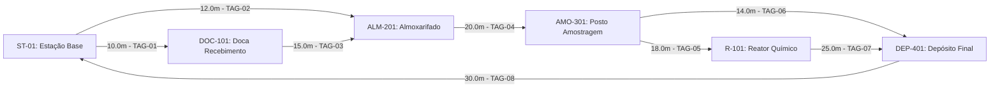

Aqui está a proposta de layout funcional para uma planta fabril fictícia de adubos granulados e organominerais, projetada com base nas boas práticas da indústria química/fertilizantes: fluxo linear de produção, segregação de matérias-primas, facilidade logística de expedição e integração com a frota de veículos autônomos guiados por visão computacional (**SCADA-Core / Visão-AGV**).

---

### **Visão Geral do Layout Fabril**

```
  [PORTARIA / BALANÇA / ADMINISTRATIVO]
                     │
 ┌───────────────────┴───────────────────┐
 │                                       │
 ▼                                       ▼
┌─────────────────────────┐             ┌─────────────────────────┐
│  ARMAZENAMENTO DE       │             │  ARMAZENAMENTO DE       │
│  INSUMOS / MATÉRIAS-PRI.│             │  PRODUTOS ACABADOS      │
│  (Galpão A - Entrada)   │             │  (Galpão B - Saída)     │
│  [DOC-101 / ALM-201]    │             │  [DEP-401 / Expedição]  │
└────────────┬────────────┘             └────────────▲────────────┘
             │                                       │
             ▼                                       │
┌────────────────────────────────────────────────────┴────────────┐
│                  ÁREA DE PROCESSAMENTO E MISTURA                │
│    Dosagem ➔ Moagem ➔ Granulação/Mistura ➔ Ensaque/Bagging      │
│           [ST-01 / AMO-301 / Reator Químico R-101]              │
└─────────────────────────────────────────────────────────────────┘
```

---

### **Detalhamento dos Setores**

#### **1. Setor de Recebimento e Armazenamento de Insumos (Galpão A)**

Área projetada para receber grandes volumes a granel e insumos líquidos com isolamento para evitar contaminação e umidade.

* **Boxes Silos Granel:** Divisórias em concreto para estocagem de macronutrientes:
  * *Box 1:* Nitrogênio (Ureia / Nitrato de Amônio).
  * *Box 2:* Fósforo (Superfosfato Simples / MAP / DAP).
  * *Box 3:* Potássio (Cloreto de Potássio - KCl).
* **Área de Matéria Orgânica e Micronutrientes:** Espaço coberto e ventilado para cama de frango tratada, torta de filtro, enxofre, zinco, boro e manganês em sacos ou *big bags*.
* **Tanques de Insumos Líquidos:** Bacia de contenção com tanques verticais para aditivos de revestimento (óleo antipó, polímeros) e condicionadores fluidos.
* **Moega de Recepção:** Sistema de descarga de caminhões basculantes conectado a correias transportadoras cobertas que alimentam os boxes.

---

#### **2. Área de Processamento e Formulação (Núcleo Fabril)**

Fluxo contínuo e automatizado em circuito fechado para minimização de poeira.

* **Silos de Dosagem Automática:** Balanças dosadoras alimentadas por correias diretamente dos boxes de insumos.
* **Moinho e Misturador Industrial:** Moinho de martelo para homogeneização dos sólidos e misturador horizontal de grande capacidade (*ribbon blender* ou tambor rotativo).
* **Linha de Granulação, Reação e Secagem:**
  * Reator químico (`R-101`) e prato/tambor de granulação com adição de aglomerantes fluidos e amônia ($\text{NH}_3$).
  * Secador rotativo a gás/biomassa seguido de resfriador de leito fluidizado.
  * Peneiramento e aplicação de revestimento antipó (*coating*).
* **Sistema de Exaustão e Lavagem de Gases:** Ciclones e lavadores para retenção de particulados (atendimento às normas ambientais).

---

#### **3. Setor de Embalagem e Armazenamento de Produtos Acabados (Galpão B)**

Área ampla, limpa e protegida da umidade, projetada para giro rápido de estoque e movimentação contínua de empilhadeiras e AGVs.

* **Ensaque Automático:**
  * Ensacadora de 25 kg / 50 kg para adubos ensacados.
  * Estação de carregamento de *Big Bags* (500 kg a 1.000 kg).
* **Paletização e Linha de *Stretch*:** Envolvedora automática para proteger os paletes contra umidade no transporte.
* **Estoque de Produtos Prontos (`DEP-401`):**
  * *Racks* ou áreas demarcadas por tipo de formulação (ex: NPK 04-14-08, NPK 10-10-10, Organomineral Premium).
  * Corredores largos (mínimo 4 metros) para movimentação segura de empilhadeiras e AGVs.

---

#### **4. Logística e Expedição**

* **Plataforma de Carregamento (Docas Elevadas):** Capacidade para carregamento simultâneo de múltiplos caminhões.
* **Carregamento Direto a Granel:** Silo elevado para expedição rápida diretamente na caçamba dos caminhões.
* **Fluxo de Tráfego Interno:** Anel viário de sentido único (Guarita ➔ Balança Rodoviária de Entrada ➔ Descarga/Carga ➔ Balança de Saída).

---

### **Estrutura do Grafo Logístico Regional**

Para estruturar o **Grafo de Rotas Logísticas (Suprimentos e Distribuição)** dessa unidade fabril, consideramos **Itajubá (Sul de Minas Gerais)** como o nó central (*Hub Fabril*), aproveitando a malha rodoviária estratégica conectada pela BR-459, Fernão Dias (BR-381) e Dutra (BR-116).

```
 [FORNECEDORES / ORIGENS]                   [MUNICÍPIOS / REGIONAL]                      [CLIENTES / DESTINOS]
 
 (Santos/SP) ───────┐                                                               ┌───> [Pouso Alegre - MG]
 (Maciço de Poços) ─┼──> [GALPÃO A: INSUMOS] ──> [ÁREA FABRIL] ──> [GALPÃO B: PROD.] ┼──> [Guaratinguetá/Taubaté - SP]
 (Região de Passos)─┘      (Recepção/Boxes)       (Formulação)     (Expedição)      └───> [São Lourenço/Caxambu - MG]
```

---

### **Detalhamento dos Nós Regionais (Nodes)**

#### **1. Nó Central (Hub Fabril)**

* **$[N_0]$ Planta Fabril (Itajubá - MG):** Nó principal de convergência e processamento.
* **$[N_{0A}]$ Sub-nó Galpão A (Insumos):** Ponto de descarga de matéria-prima (Moega, Boxes e Tanques).
* **$[N_{0B}]$ Sub-nó Galpão B (Produtos Acabados):** Ponto de saída para expedição (Docas).

#### **2. Nós de Origem (Recolhimento de Insumos)**

* **$[N_{I1}]$ Porto de Santos (SP):** Importação de KCl (Cloreto de Potássio) e Ureia.
* **$[N_{I2}]$ Poços de Caldas / Andradas (MG):** Mineração e rocha fosfática (Fósforo).
* **$[N_{I3}]$ Região do Sul de Minas / Passos (MG):** Cama de frango e matéria orgânica para linha Organomineral.

#### **3. Nós de Destino (Entrega de Adubos)**

* **$[N_{D1}]$ Eixo BR-459 Ocidental (Pouso Alegre / Santa Rita do Sapucaí - MG):** Hortifrúti, grãos e milho.
* **$[N_{D2}]$ Eixo Vale do Paraíba (Guaratinguetá / Taubaté / Lorena - SP):** Pastagens e horticultura.
* **$[N_{D3}]$ Eixo Circuito das Águas (São Lourenço / Carmo de Minas - MG):** Cafeicultura de alta precisão.

---

### **Detalhamento das Arestas Regionais (Edges e Trajetos)**

| Origem / Destino | Aresta (Rota) | Tipo de Carga | Modal / Rodovia | Distância Média |
| --- | --- | --- | --- | --- |
| $[N_{I1}] \rightarrow [N_{0A}]$ | **Inbound (Recolhimento)** | Ureia / KCl a granel | Bitrem (BR-116 / SP-125 / BR-459) | ~320 km |
| $[N_{I2}] \rightarrow [N_{0A}]$ | **Inbound (Recolhimento)** | Rocha Fosfática / Calcário | Trucado / Carreta (BR-459) | ~140 km |
| $[N_{I3}] \rightarrow [N_{0A}]$ | **Inbound (Recolhimento)** | Resíduos Orgânicos | Caçamba basculante (BR-381 / BR-459) | ~200 km |
| $[N_{0B}] \rightarrow [N_{D1}]$ | **Outbound (Entrega)** | NPK Saco/Big Bag | Truck 14t (BR-459) | ~60 km |
| $[N_{0B}] \rightarrow [N_{D2}]$ | **Outbound (Entrega)** | Organomineral Bag | Carreta 30t (BR-459 / SP-183 / BR-116) | ~70 km |
| $[N_{0B}] \rightarrow [N_{D3}]$ | **Outbound (Entrega)** | Formulações Especiais Café | Truck 14t (BR-459 / MGG-383) | ~80 km |

---

### **Mapeamento da Logística Reversa (Logística de Retorno)**

Para otimizar o custo de frete (evitar "rodar vazio"), o grafo possui arestas bidirecionais programadas:

* **Ciclo Reverso de Paletes e Big Bags:**

$$\text{Entrega } [N_{0B}] \rightarrow [N_{D1/D2/D3}] \quad \xrightarrow{\text{Recolhimento de Embalagens/Paletes Vazios}} \quad [N_{0A}]$$

* **Triangulação Inbound/Outbound:** Caminhões que entregam adubo ensacado no Vale do Paraíba $[N_{D2}]$ retornam via Dutra/Santos $[N_{I1}]$ trazendo insumos importados para a fábrica $[N_{0A}]$.

---

### **Integração da Malha Topológica do AGV Logístico Visão-Computacional (Setor 300 — Modo Follow-Me)**

Na interface interna entre o **Galpão A (Insumos)**, a **Área de Processamento (Núcleo Fabril)** e o **Galpão B (Produtos Acabados)**, opera o **AGV Logístico e de Amostragem Guiado por Visão Computacional** modelado na Etapa 01 (Setor 300). O veículo percorre uma malha topológica dirigida e ponderada $G = (V, E, W)$ com $|V| = 6$ estações e $|E| = 8$ corredores industriais demarcados por *tags* RFID/ópticas.

#### **1. Estações Topológicas (Vértices $V$) no Layout da Planta**

| Vértice (Tag) | Nome da Estação | Localização no Layout Fabril | Função Operacional | Coordenadas $(x, y)$ [m] |
| --- | --- | --- | --- | --- |
| `ST-01` | Estação Base / Recarga | Setor 300 — Pátio Central de Manutenção | Ponto de partida, recarga indutiva de baterias e despacho de missões | $(0, 0)$ |
| `DOC-101` | Doca de Recebimento | Galpão A — Recepção de Insumos | Coleta de lotes recém-descarregados para conferência e transferência | $(0, 20)$ |
| `ALM-201` | Almoxarifado Central | Galpão A — Boxes e Tanques de Insumos | Retirada de reagentes químicos, micronutrientes e insumos fracionados | $(20, 25)$ |
| `AMO-301` | Posto de Amostragem / Lab | Transição Galpão A ➔ Núcleo Fabril | Hub de controle de qualidade, pesagem fina e triagem laboratorial | $(45, 25)$ |
| `R-101` | Reator Químico / Processo | Núcleo Fabril — Granulação e Reação | Ponto de coleta de amostras em processo com braço robótico e dosagem | $(45, 0)$ |
| `DEP-401` | Depósito Final / Expedição | Galpão B — Estoque de Produtos Prontos | Entrega de lotes aprovados/amostras consolidadas e retorno à base | $(15, 0)$ |

#### **2. Corredores Dirigidos (Arestas $E$ e Pesos $W$)**



* **`TAG-01` (`ST-01 -> DOC-101`, $10.0\text{ m}$):** Acesso da base de recarga à doca de recebimento do Galpão A.
* **`TAG-02` (`ST-01 -> ALM-201`, $12.0\text{ m}$):** Acesso direto da base ao almoxarifado de insumos.
* **`TAG-03` (`DOC-101 -> ALM-201`, $15.0\text{ m}$):** Corredor interno de internação de insumos da doca para o almoxarifado.
* **`TAG-04` (`ALM-201 -> AMO-301`, $20.0\text{ m}$):** *Ponte crítica* que conecta o Galpão A ao Posto de Amostragem.
* **`TAG-05` (`AMO-301 -> R-101`, $18.0\text{ m}$):** Ramal de inspeção e coleta de amostras junto ao Reator Químico.
* **`TAG-06` (`AMO-301 -> DEP-401`, $14.0\text{ m}$):** Corredor expresso (*bypass* do reator) rumo ao Depósito Final no Galpão B.
* **`TAG-07` (`R-101 -> DEP-401`, $25.0\text{ m}$):** Saída da área do reator para consolidação no Galpão B.
* **`TAG-08` (`DEP-401 -> ST-01`, $30.0\text{ m}$):** Corredor periférico de retorno do Galpão B à Estação Base para fechamento de ciclo.

#### **3. Instrumentação Embarcada e Ambiental (Sensores e Atuadores da Etapa 01)**

A navegação do AGV sobre os grafos das Aulas 11 a 18 é governada em malha fechada pelos sensores e atuadores especificados na Etapa 01:

* **Sensores de Visão e Segurança Operacional:**
  * **`CAM-101` (Câmera Estéreo Frontal — Modo *Follow-Me*):** Identifica o marcador/operador guia ($c_1, c_2$) e calcula o erro lateral $\Delta x$ para alinhamento nos corredores `TAG-01` a `TAG-08`.
  * **`CAM-102` (Câmera de Profundidade / Detecção de Obstáculos):** Monitora a *bounding box* de segurança frontal ($d_1 = 1$ quando a distância é menor que o limite seguro), disparando a reponderação dinâmica $W(u,v) \leftarrow \infty$ estudada na Aula 15.
  * **`AT-201` (Analisador/Transmissor de Amônia $\text{NH}_3$):** Instalado na zona do Reator `R-101` e corredores adjacentes; se a concentração exceder $25\text{ ppm}$ ($g_1 = 1$), interdita o corredor contaminado no grafo ou aciona o *Trip* do SIS.
  * **`BT-201` (Monitor de Bateria):** Supervisiona o estado de carga ($\text{SoC} < 15\% \implies b_1 = 1$), forçando o roteamento prioritário de retorno para `ST-01`.
  * **`ESD-200` (Botão de Emergência / Comando de *Trip* SIS IEC 61511):** Intertravamento de segurança máxima ($e_1 = 1$) que bloqueia imediatamente a tração quando uma ponte crítica (como `TAG-04`) é obstruída sem rota alternativa ($d = \infty$).
* **Atuadores nos Três Eixos Cinemáticos e Sinalização:**
  * **`M-301` (Motor de Tração Principal — Eixo Z):** Responsável pelo deslocamento longitudinal ($m_1$) ao longo das arestas do grafo.
  * **Servo de Esterçamento (Eixo X):** Executa as manobras angulares nas inflexões entre vértices (minimizado pela busca BFS na Aula 13).
  * **`A-301` (Braço Robótico de Amostragem — Eixo Y):** Atuador vertical ($a_1$) que coleta amostras físico-químicas em estações como `R-101` e `AMO-301`, sujeito à restrição lógica estrita de intertravamento $a_1 \rightarrow \neg m_1$ (o braço só opera com o AGV perfeitamente estacionado no vértice).
  * **`ALM-301` (Alarme Audiovisual de Segurança):** Sinalizador industrial acionado em condição de *Trip* ou perda de conectividade topológica ($\text{ALM-301} = 1$).
